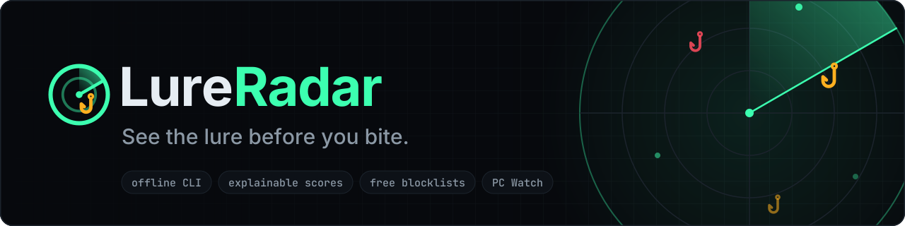
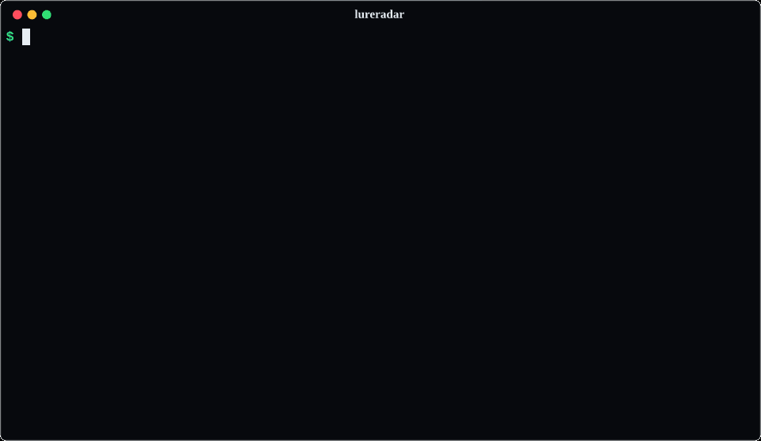
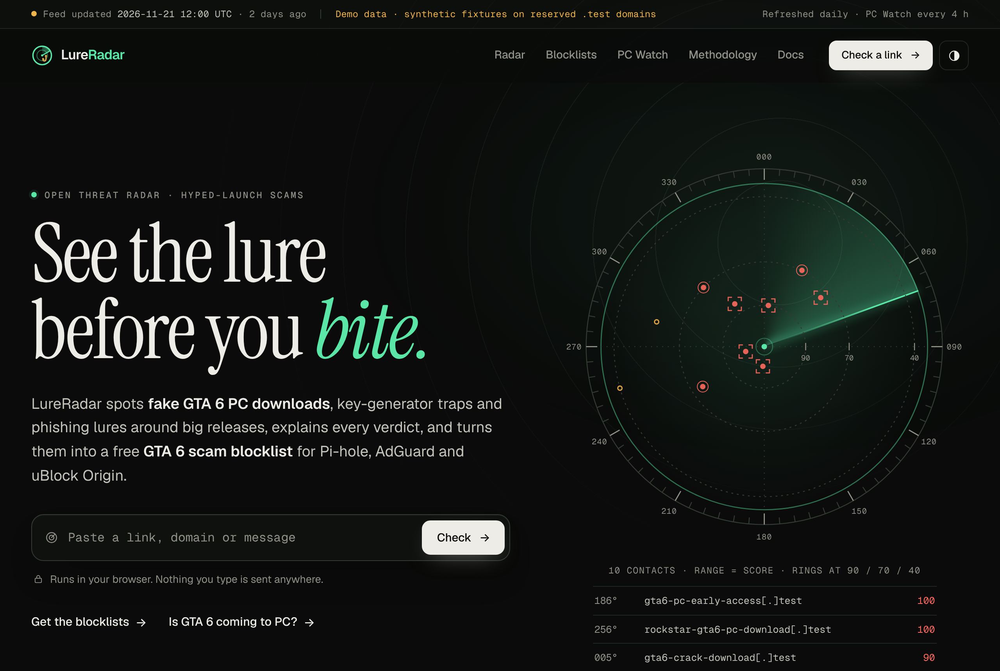
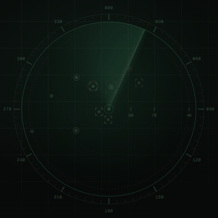

<p align="center">
  
</p>

<h1 align="center">LureRadar: GTA 6 scam and fake-download radar</h1>

<p align="center"><strong>See the lure before you bite.</strong><br>
Open threat radar for hyped-launch scams: fake downloads, key-gen traps and phishing, starting with GTA 6.</p>

<p align="center">
  <a href="https://github.com/AbdelrahmanMostafa-Eng/LureRadar/actions/workflows/ci.yml"></a>
  <a href="https://abdelrahmanmostafa-eng.github.io/LureRadar/pc-watch/"></a>
  <a href="https://abdelrahmanmostafa-eng.github.io/LureRadar/radar/"></a>
  <a href="https://abdelrahmanmostafa-eng.github.io/LureRadar/feeds/"></a>
  <a href="docs/BENCHMARKS.md"></a>
  <a href="https://scorecard.dev/viewer/?uri=github.com/AbdelrahmanMostafa-Eng/LureRadar"></a>
  <a href="https://pypi.org/project/lureradar/"></a>
  <a href="LICENSE"></a>
</p>

<p align="center">
  
</p>

<p align="center">
  
  
</p>

## Why this exists

GTA VI launched on 2026-11-19 on PlayStation 5 and Xbox Series X|S, and as
of 2026-11-21 Rockstar had not announced a PC version ([dated, sourced facts](packs/gta6/facts.yaml)),
so every "free GTA 6 PC download", "beta key" or "Steam key generator" is a
lure. Hyped launches reliably spawn waves of fake download sites, key-gen
traps and phishing that reach players through search ads, comments and DMs.
LureRadar spots them early, explains exactly why, and turns them into free
blocklists anyone can use.

## Quickstart

```bash
uvx lureradar check "https://rockstar-gta6-pc-download[.]test/free-key"
```

No setup, no account, **no network**: the check runs offline. It also takes
a domain or a whole message (`lureradar check "free GTA 6 PC beta key, DM me
on Telegram"`). Prefer a permanent install: `pipx install lureradar`.
More in the [quickstart](docs/QUICKSTART.md).

## Protect yourself in 60 seconds

| Where | Subscribe to |
|---|---|
| **Pi-hole** (Adlists) | `https://abdelrahmanmostafa-eng.github.io/LureRadar/feeds/hosts.txt` |
| **AdGuard / AdGuard Home** (custom list) | `https://abdelrahmanmostafa-eng.github.io/LureRadar/feeds/adguard.txt` |
| **uBlock Origin** (Filter lists → Import) | `https://abdelrahmanmostafa-eng.github.io/LureRadar/feeds/adguard.txt` |
| **Unbound / BIND** (RPZ) | `https://abdelrahmanmostafa-eng.github.io/LureRadar/feeds/rpz.zone` |

Step-by-step: [Pi-hole](examples/pihole.md) · [AdGuard](examples/adguard.md) ·
[uBlock Origin](examples/ublock.md) · [Unbound RPZ](examples/unbound-rpz.md).
Blocklists only contain **LIKELY** and **CONFIRMED** indicators.

## What you get

| | |
|---|---|
| 🔎 **Offline checker** | `lureradar check` for links, domains and messages; defanged input welcome; `--json` with a versioned schema; CI-friendly exit codes |
| 🧠 **Explainable engine** | Every score is a sum of named signals with evidence. No ML, no LLM in the scoring path |
| 🛡️ **Free blocklists** | hosts, domains, AdGuard/uBlock, RPZ, JSON, CSV, STIX 2.1; daily, checksummed and signed |
| 🖥️ **PC Watch** | "Is GTA 6 coming to PC?" from official sources only, with a maintainer in the loop and an RSS/Atom feed |
| 📡 **Pipeline** | Certificate Transparency + public feeds → prefilter → hardened enrichment → score → feeds, on GitHub Actions |
| 🌐 **Dashboard** | Radar, detections, client-side link checker (sends nothing anywhere), subscribe snippets |
| 💬 **Message analyzer** | Scores DMs, comments and ads: fake platforms, gift-card payment, "disable your antivirus", shorteners |
| 🧩 **Campaign packs** | Add a new launch in ~20 lines of YAML ([template pack](packs/example-launch/)) |
| 🧭 **Browser extension** | Local-only MV3 extension warns before a listed site loads ([extension/](extension/README.md)) |
| 🐳 **Self-hosted watch** | `lureradar watch` consumes a CT stream and publishes feeds; `docker compose up -d` |

## How it works

```mermaid
flowchart LR
  A[Sources\nCT logs, OpenPhish, URLhaus,\nurlscan, community reports] --> B[Lexical prefilter\ncampaign relevance]
  B --> C[Enrich\nDNS, RDAP, TLS,\nhardened HTTP]
  C --> D[Score\nnamed signals + tiers]
  D --> E[Feeds\nsigned blocklists]
  D --> F[Dashboard\nGitHub Pages]
  G[PC Watch\nofficial sources] -.facts.yaml.-> D
```

Details: [how it works](docs/HOW_IT_WORKS.md) · [signals and weights](docs/SIGNALS.md) ·
[threat model](docs/THREAT_MODEL.md).

## Example verdict

```text
╭─ ◉ LureRadar ──────────────────────────────────────────────────────────────────────╮
│   LIKELY LURE    75/100  ██████████████████████░░░░░┊░░                            │
│                                                                                    │
│  hxxps://rockstar-gta6-pc-download[.]test/free-key                                 │
│  Looks like a launch lure: unreleased platform + brand impersonation               │
│                                                                                    │
│  WHY                                                                               │
│    +30  claims_unreleased_platform  Promises "download" of GTA VI for PC: no       │
│                                     official PC release exists (fact pc_release,   │
│                                     as of 2026-11-21)                              │
│    +25  brand_impersonation         Combosquat: "rockstar" (Rockstar Games) plus   │
│                                     other words                                    │
│    +20  keyword_intent_combo        Keyword "gta6" + intent "pc", "download" in    │
│                                     the hostname                                   │
│                                                                                    │
│  WHAT TO DO NEXT                                                                   │
│  › Fact check: As of 2026-11-21 Rockstar Games has not officially announced a PC   │
│    version of Grand Theft Auto VI or a PC release date. (packs/gta6/facts.yaml)    │
│  › Do not visit, download, enter credentials or pay.                               │
│  › Block it: subscribe to the LureRadar feeds (Pi-hole, AdGuard, uBlock Origin).   │
│  › Report it: issue form ↗                                                         │
│  › Think this is wrong? Dispute it: issue form ↗                                   │
╰───────────────────────────────────────── packs: gta6 · offline · exit 20 · v0.1.0 ─╯
```

## Live stats

The badges above read live JSON published with every feed run
(`feeds/shields-*.json`, `feeds/stats.json`). The [dashboard](https://abdelrahmanmostafa-eng.github.io/LureRadar/)
shows the latest detections, each with its signals and a dispute link. Feeds
refresh daily on a best-effort GitHub Actions schedule; every file carries
`generated_at`. The dashboard screenshot above shows synthetic demo data.

## Accuracy

Reproduce with `make bench` ([full report](docs/BENCHMARKS.md)):

| Measurement | Result |
|---|---|
| False positives at LIKELY+ on **522 real benign domains** (game press, studios, stores, wikis, fan sites, platforms) | **0** (also 0 with allowlists switched off) |
| False positives at LIKELY+ on 50 keyword-bearing fan/news hard negatives | 0 |
| Synthetic in-scope lures flagged offline, LIKELY+ / SUSPICIOUS+ | 6.9% / 48.6% |
| Same lures when newly registered (as the live pipeline sees them), LIKELY+ / SUSPICIOUS+ | 40.9% / 99.4% |
| Synthetic lure messages: precision / recall at LIKELY+ | 100% / 81.7% |

**Limitations, honestly:** offline lexical evidence is deliberately
conservative (blocklists need live signals to reach LIKELY); the lure corpus
is synthetic and written by the same maintainers as the detectors; source
adapters were verified against recorded fixtures because the build machine
had no egress ([sources status](docs/SOURCES.md)). Known blind spots are listed
in the [benchmark report](docs/BENCHMARKS.md#known-blind-spots).

## Campaign packs

GTA VI is the first pack. Adding a launch (a console, a game, a device) takes
about 20 lines of YAML: keywords, intents, brands (names, never logos), an
allowlist, and dated, sourced facts that drive the rules.

```bash
lureradar pack new console-x --name "Console X"
lureradar pack validate packs/console-x
```

See [docs/PACKS.md](docs/PACKS.md).

## Feeds and formats

| File | Format | For |
|---|---|---|
| `feeds/hosts.txt` | `0.0.0.0 domain` | Pi-hole, hosts files, routers |
| `feeds/domains.txt` | one domain per line | Pi-hole, AdGuard Home, NextDNS |
| `feeds/adguard.txt` | `\|\|domain^` | AdGuard, uBlock Origin |
| `feeds/rpz.zone` | DNS RPZ | BIND, Unbound, Knot, PowerDNS |
| `feeds/latest.json` | JSON ([schema](docs/SCHEMA.md)) | apps, scripts |
| `feeds/stix.json` | STIX 2.1 | TIPs, MISP, OpenCTI |
| `feeds/indicators.csv` | CSV | SIEM lookups, spreadsheets |
| `feeds/pc-watch.atom` | Atom | RSS readers |

Everything is CC0, checksummed (`SHA256SUMS`) and signed (minisign format):
`lureradar feed verify ./feeds`. Details: [docs/FEEDS.md](docs/FEEDS.md).

## Privacy and ethics

- `check` is offline by default and sends nothing; `--live` says what it contacts.
- The web checker runs in your browser. No cookies, no trackers, no telemetry anywhere.
- Defensive only: we never execute or download what we analyse, and we refuse
  features that help create or disguise lures ([ethics policy](docs/ETHICS_AND_ABUSE.md), [privacy](docs/PRIVACY.md)).
- Detections are automated and may contain false positives. No warranty.
  Every listing links to a dispute form.

## Contributing

<p>
  <a href="https://github.com/AbdelrahmanMostafa-Eng/LureRadar/issues/new?template=report-a-lure.yml"></a>
  <a href="https://github.com/AbdelrahmanMostafa-Eng/LureRadar/issues/new?template=false-positive-review.yml"></a>
</p>

Your first PR can take 10 minutes: see [CONTRIBUTING.md](CONTRIBUTING.md).
`make check` runs everything CI runs. Please read the
[code of conduct](CODE_OF_CONDUCT.md) and [security policy](SECURITY.md).

## Roadmap

Browser-store listings for the extension, more campaign packs, Telegram/Discord lure
intelligence, SIEM connectors and multilingual message patterns. See
[ROADMAP.md](ROADMAP.md).

## Sponsors

LureRadar accepts no sponsorship yet. If that changes, sponsors will be
listed here and will never influence what gets listed.

## License and trademarks

Code: [MIT](LICENSE). Feed data: [CC0-1.0](DATA_LICENSE). Cite it with
[CITATION.cff](CITATION.cff).

LureRadar is an independent project, not affiliated with, endorsed by, or
sponsored by Rockstar Games, Take-Two Interactive, or any platform holder.
All trademarks belong to their owners. See [TRADEMARKS.md](TRADEMARKS.md).
