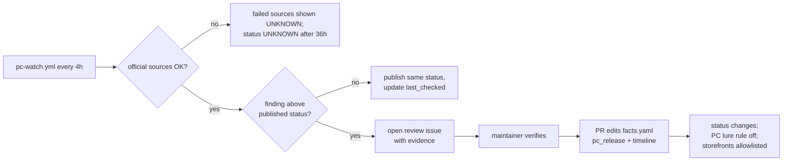

# PC Watch: is GTA 6 coming to PC?

PC Watch answers the most-asked launch question with **dated, official,
sourced** facts, and it is the factual backbone of LureRadar's GTA VI rules:
while no PC version exists, every "GTA 6 PC download" is a lure.

It is designed to be humble. A wrong "no" or a fake "yes" would destroy
trust, so automation can never change the published status on its own.

> LureRadar is an independent, unofficial project, not affiliated with
> Rockstar Games or Take-Two Interactive.

## Status

| Status | Meaning |
|---|---|
| `NOT_ANNOUNCED` | No official PC release has been announced (as of the last successful check). |
| `ANNOUNCED_UNDATED` | An official source announced a PC version without a date. |
| `ANNOUNCED_DATED` | An official source announced a PC version with a date or window. |
| `RELEASED` | The PC version is officially available. |
| `UNKNOWN` | Checks are stale or failing. Never replaced by `NOT_ANNOUNCED` on failure. |

The page always says "No official PC release has been announced as of
<timestamp>", never "will never come to PC".

## Source policy (strict)

Only **primary, official** sources are consulted: Rockstar Games' official
site and Newswire, Take-Two Interactive investor relations and SEC filings,
and official storefront listings. Press articles, leakers, rumours, videos
and non-official social posts never change the status. They may appear on
the timeline only as "Reported / unconfirmed" items, off by default.

| Source | Endpoint | Format | Required | Status at build time |
|---|---|---|---|---|
| Rockstar Games Newswire | `rockstargames.com/newswire` | unsupported | no | renders client-side: no server-rendered list and no RSS/Atom (verified 2026-11-24); its announcements are republished by Take-Two and SEC filings |
| Take-Two press releases | `take2games.com/ir/press-releases` | HTML listing | yes | live OK 2026-11-24 (5 GTA VI items, 0 PC findings); moved from `/ir/news` |
| SEC EDGAR (Take-Two 8-K) | `sec.gov` Atom feed | Atom | no | live OK 2026-11-24 (40 items) |
| Steam store search | `store.steampowered.com/api/storesearch` | JSON | no | live OK 2026-11-24 |
| Epic Games Store, Microsoft Store, PlayStation Store | none verified | unsupported | no | shown as UNKNOWN for that source |
| Rockstar official social accounts | APIs need credentials | unsupported | no | announcements are mirrored by Take-Two press releases |

The build sandbox for v0.1.0 had no egress, so live structure checks run in
the `pc-watch` workflow. Every source declares `expect_min_items`: if a page
yields fewer game-related items than expected (for example because it became
JavaScript-rendered), the source counts as **failed**, not as "nothing
announced".

## Rules (`src/lureradar/pcwatch/evaluate.py`)

A statement becomes a finding only if all three hold:

1. its URL is on the source's official domains;
2. it names the game;
3. a PC platform term (PC, Windows, Steam, Epic Games Store, Microsoft Store,
   Rockstar Games Launcher) is in the title or within 140 characters of the
   game's name.

"Available now / out now" nearby means `RELEASED`; a date or window nearby
means `ANNOUNCED_DATED`; otherwise `ANNOUNCED_UNDATED`. Negations ("no plans
for PC") are flagged. A Steam listing named exactly like the game is
evidence too.

## Human in the loop



- The published status is the `pc_release` fact in `packs/gta6/facts.yaml`.
- Flipping it requires a maintainer-approved commit. Fake pages, compromised
  sources or parser bugs can open an issue, never flip the status.
- Downgrades to `UNKNOWN` are automatic: if the last fully successful check
  (all required sources OK) is older than **36 hours**, the page shows
  `UNKNOWN (last confirmed NOT_ANNOUNCED on <date>)`.

## Coupling to detection

`claims_unreleased_platform` reads the same fact. When the `pc_release`
status becomes `announced_undated`, `announced_dated` or `released`, the
signal drops to 0 for PC claims on the next pipeline run, and the official
PC storefronts listed in `pc_watch.yaml` are allowlisted. A legitimate
release is never called a scam. Other unreleased platforms (mobile,
last-gen, Nintendo) keep firing. Both states are covered by tests.

## Evidence timeline

`packs/gta6/pc_watch.yaml` holds the timeline: date, source, link, a short
paraphrase in our own words (at most 15 quoted words), "what it means", and
how and when it was verified. At build time we seeded only entries verified
with a live lookup:

| Date | Source | Statement (paraphrased) |
|---|---|---|
| 2025-11-06 | Rockstar Newswire | Launch moved to 19 Nov 2026 on PS5 and Xbox Series X\|S; no PC named. |
| 2026-11-19 | Rockstar Newswire | Game available worldwide on PS5 and Xbox Series X\|S. |
| 2026-11-19 | Take-Two press release | Launch confirmed on PS5 and Xbox Series X\|S. |

Verification method for all three: live search-index lookup of the official
URLs on 2026-11-21 (direct fetch was blocked by the build sandbox).

## Outputs

- `/pc-watch/` page: status banner, last checked, last changed, timeline, FAQ.
- `feeds/pc-watch.json`: full state (`schema_version`, `generated_at`, `count`).
- `feeds/pc-watch.atom`: Atom 1.0 feed for RSS readers.
- `feeds/shields-pc-watch.json`: README badge ("PC version: not announced · checked ...").

## Subscribe

- **RSS / Atom reader**: add `feeds/pc-watch.atom` from the site.
- **Discord / Slack**: see [examples/pc-watch-webhook.md](../examples/pc-watch-webhook.md).
- **Your own GitHub Action**: fork the repository and keep `pc-watch.yml`.
- No accounts and no email collection.

## CLI

```bash
lureradar pcwatch status
```

```bash
lureradar pcwatch check --out ./feeds --issue-body issue.md
```

```bash
lureradar pcwatch history
```

## FAQ

**Is a GTA 6 PC download real?** As of the date in `facts.yaml`, no official
PC version has been announced, so a "GTA 6 PC download" is not genuine. Use
`lureradar check` on any link you see.

**How will I know when PC is announced?** Subscribe to the Atom feed. When an
official source announces it, a maintainer confirms it and the status changes.
