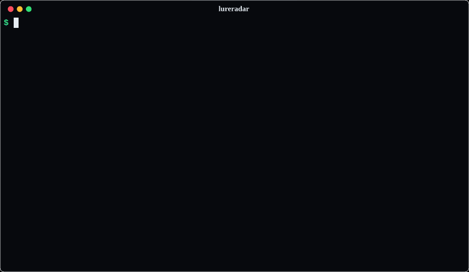

## Highlights



- **Check anything offline**: `uvx lureradar check "<link, domain or message>"`
  explains every point of the score and exits with a CI-friendly code.
- **Free daily blocklists** for Pi-hole, AdGuard, uBlock Origin and DNS RPZ,
  plus JSON, CSV and STIX 2.1, with checksums and minisign-format signatures.
- **PC Watch**: "Is GTA 6 coming to PC?" from official sources only, with a
  maintainer in the loop and an Atom feed.
- **Precision first**: 0 false positives at LIKELY+ on 522 real benign
  domains (`make bench`, docs/BENCHMARKS.md), blind spots documented.
- **Hardened by design**: SSRF-safe fetcher, signed feeds, SHA-pinned
  workflows, Sigstore signatures, provenance attestations and a CycloneDX SBOM.

## Verify this release

```bash
scripts/verify_release.sh lureradar-0.1.0-py3-none-any.whl SHA256SUMS
```

## Known limitations

- Source adapters were built against recorded fixtures because the build
  environment had no egress; the first scheduled CI run verifies them live
  (docs/SOURCES.md).
- Feed signatures activate once maintainers publish the signing key (keys/README.md).
- Offline recall is intentionally conservative; see docs/BENCHMARKS.md.
